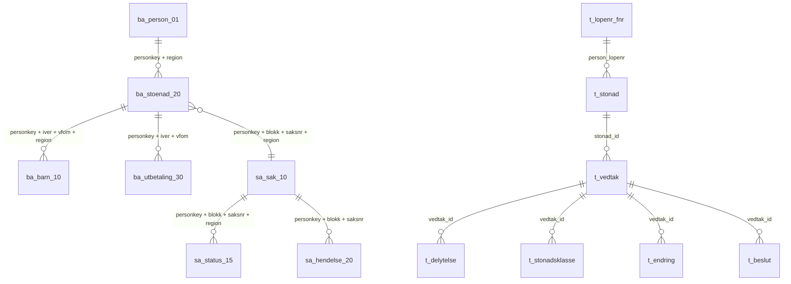

# Tabeller i replika

Replika er en lesekopi av barnetrygd-dataene i Infotrygd. Dataene replikeres til Postgres i GCP. Replika skriver aldri tilbake til Infotrygd.

Skjemaet er definert i `src/main/resources/db/migration` (V1–V4). Tabellnavn og kolonnenavn er beholdt fra Infotrygd, slik at spørringene kan sammenlignes direkte med kilden.

Betydningen av kodene i kodefeltene står i [kodeverk.md](kodeverk.md). Beskrivelsene bygger på koden i dette repoet og på «Brukerhåndbok Infotrygd 06 Barnetrygd» (Rikstrygdeverket, 1997), «Infotrygd Brukerhåndbok 14 Saksbehandlingsrutinen» (Arbeids- og velferdsdirektoratet, sist endret 2016) og Confluence-siden «Databaser» under Modernisering av IKT i Nav.

## Oversikt

Tabellene kommer fra to ulike kilder i Infotrygd:

| Gruppe | Kilde i Infotrygd | Tabeller | Personnøkkel |
|---|---|---|---|
| Barnetrygd (DL1) | Stønadsdata for barnetrygd | `ba_person_01`, `ba_stoenad_20`, `ba_barn_10`, `ba_utbetaling_30` | `b01_personkey` + `region` |
| Sak (DL1) | Felles saksregister | `sa_sak_10`, `sa_status_15`, `sa_hendelse_20` | `s01_personkey` + `region` |
| Vedtak (DB2) | Vedtaksdatabasen | `t_lopenr_fnr`, `t_stonad`, `t_vedtak`, `t_delytelse`, `t_stonadsklasse`, `t_endring`, `t_beslut` | `person_lopenr` |

Tallet i navnet (`_01`, `_10`, `_20` …) er segmentnummeret fra Infotrygd. Prefikset på kolonnene (`b20_`, `s10_`) viser hvilket segment kolonnen hører til.

## Datamodell

Det finnes ingen fremmednøkler i databasen. Relasjonene over følger av spørringene i `repository/`. DL1 og DB2 kobles bare via fødselsnummer (`f_nr` / `personnr`) og saksnøkkel (`saksblokk` + `saksnr`).

## Felles konvensjoner

### Fødselsnummer

| Kolonne | Format | Konverter |
|---|---|---|
| `f_nr` i DL1-tabellene | Reversert, tekst. `00000000000` betyr ukjent | `ReversedFoedselNrConverter` |
| `b10_barn_fnr` | Reversert, tall (ledende nuller forsvinner) | `ReversedLongFoedselNrConverter` |
| `personnr` i `t_lopenr_fnr` | Vanlig fødselsnummer | – |

#### Slik er fødselsnummeret snudd

I DL1 er fødselsdatoen snudd fra `ddmmåå` til `ååmmdd`. Personnummeret (de fem siste sifrene) står uendret. Formatet gjør at kolonnen kan sorteres og søkes på fødselsdato.

| | Dag | Måned | År | Personnummer |
|---|---|---|---|---|
| Vanlig | `dd` | `mm` | `åå` | `nnnnn` |
| Reversert | `åå` | `mm` | `dd` | `nnnnn` |

Eksempel med fiktivt nummer: `01028512345` lagres som `85020112345`.

Operasjonen er sin egen invers: å snu to ganger gir det opprinnelige nummeret. Koden ligger i `utils/FoedselsNrUtils.kt`:

- `FoedselsNr.reversert` snur et vanlig fødselsnummer før det skrives eller brukes i en spørring.
- `FoedselsNr.fraReversert(...)` snur verdien fra databasen tilbake.
- Begge kaster `IllegalArgumentException` hvis verdien ikke er nøyaktig 11 sifre.

#### Spesialtilfeller

- **Ukjent person.** `ReversedFoedselNrConverter` leser `00000000000` som `null`, og skriver `null` som `00000000000`.
- **Tallkolonnen `b10_barn_fnr`.** Barn født 2000–2009 får `0` først i reversert form, for eksempel `05...`. Tallkolonnen mister denne nullen. `ReversedLongFoedselNrConverter` fyller derfor på med nuller til 11 sifre (`padStart(11, '0')`) før den snur tilbake.
- **DB2.** `personnr` i `t_lopenr_fnr` er ikke snudd. Ved kobling mellom DL1 og DB2 må fødselsnummeret snus på den ene siden.

Spørringer mot `f_nr` og `b10_barn_fnr` må bruke den reverserte formen. Repositoryene håndterer dette selv: de tar imot `FoedselsNr`, og JPA-konverteren snur verdien.

Alle disse kolonnene er personopplysninger. De skal ikke logges.

### Datoer

| Format | Eksempel på kolonner | Tolkning |
|---|---|---|
| Sekvensmåned, tekst | `b20_iverfom_seq`, `b20_virkfom_seq`, `b30_start_utbet_mnd_seq`, `b30_vfom_seq`, `b10_ba_iver`, `b10_ba_vfom`, `b10_ba_tom` | `999999 - ååååmm`. Se under |
| Sekvensdag, tall | `s20_aksjonsdato_seq` | `99999999 - ååååmmdd`. Se under |
| `mmåååå` | `b20_opphoert_vfom`, `b30_utbet_tom` | `000000` betyr løpende, ikke opphørt |
| `ddmmåååå` som tall | `s10_vedtaksdato`, `s10_reg_dato` | `NavReversedLocalDateConverter` |
| `ååååmmdd` som tall | `b20_reg_dato` | Antatt, ikke brukt i koden |
| `date` / `timestamp` | Alle DB2-tabellene | Vanlige Postgres-typer |

Se `utils/DatoUtils.kt`.

#### Sekvensdatoer (`_seq`)

En sekvensdato er datoen trukket fra et tall med bare niere. Nyere datoer får da lavere verdier, og en stigende sortering gir nyeste rad først. Infotrygd bruker dette for å lese siste stønad eller hendelse først.

| Variant | Beregning | Eksempel |
|---|---|---|
| Måned (6 sifre) | `999999 - ååååmm` | mars 2024: `999999 - 202403 = 797596` |
| Dag (8 sifre) | `99999999 - ååååmmdd` | 1. desember 2021: `99999999 - 20211201 = 79788798` |

Det blir aldri mente i subtraksjonen, fordi hvert siffer trekkes fra 9. Derfor kan hver del regnes ut for seg:

- De fire første sifrene er `9999 - år` (`7975` = 2024).
- De to neste er `99 - måned` (`96` = mars).
- I dagvarianten er de to siste `99 - dag`.

`000000` er ikke en sekvensdato. Verdien betyr «ingen dato», og `DatoUtils.seqDatoTilYearMonth` returnerer `null` for den. Tilsvarende betyr `000000` i `b10_ba_tom` at barnetrygden løper.

Navnet på kolonnen viser ikke alltid formatet. `b10_ba_iver`, `b10_ba_vfom` og `b10_ba_tom` mangler `_seq` i navnet, men koden leser dem som sekvensmåneder.

**Sammenligninger går motsatt vei.** Når en spørring skal finne datoer etter et tidspunkt, må den bruke «mindre enn» på sekvensverdien:

| Ønsket filter | Spørring på sekvensverdien | Brukt i |
|---|---|---|
| Aksjonsdato ≥ 1. i forrige måned | `s20_aksjonsdato_seq <= 99999999 - ååååmmdd` | `HendelseRepository`, `BarnetrygdService.harSendtBrevForrigeMåned` |
| Virkning fra og med i år `år` eller tidligere | `substring(b20_virkfom_seq, 1, 4) >= 9999 - år` | `StønadRepository` |

**Kobling mellom tabellene.** `b20_iverfom_seq` og `b20_virkfom_seq` identifiserer en stønadsperiode sammen med `b01_personkey` og `region`. De samme verdiene står i `ba_barn_10` (`b10_ba_iver`, `b10_ba_vfom`) og `ba_utbetaling_30` (`b30_start_utbet_mnd_seq`, `b30_vfom_seq`). Koblingen bruker sekvensverdiene direkte og regner dem aldri om.

### Replikeringskolonner

Disse kolonnene finnes i de fleste tabellene og beskriver raden, ikke domenet:

| Kolonne | Betydning |
|---|---|
| `opprettet` | Når raden ble opprettet i kilden |
| `endret_i_kilde` | Siste endring i Infotrygd |
| `oppdatert` | Siste endring i replika |
| `kilde_is` | Kildesystem i Infotrygd |
| `region` | Infotrygd-region (`1`, `2`, `3` …). Del av personnøkkelen i DL1 |
| `tk_nr` | Trygdekontornummer (enhet) |
| `db_splitt` | Splittnøkkel fra Oracle. `BA` for barnetrygd, `99` for sak, blank for DB2 |

## Barnetrygd (DL1)

### `ba_person_01`: person

Én rad per stønadsmottaker per bostedstrygdekontor (`tk_nr`).

| Kolonne | Betydning |
|---|---|
| `id_ba_pers` | Primærnøkkel |
| `b01_personkey` | Personnøkkel: `tk_nr` (4 sifre) etterfulgt av reversert fødselsnummer (`ååmmddnnnnn`). Finnes i alle `ba_`-tabellene og brukes til å koble dem. Samme verdi som `s01_personkey` i sakstabellene |
| `b01_bt_status` | Barnetrygdstatus |
| `b01_mottaker_kode` / `b01_mottaker_nr` | Alternativ mottaker av utbetalingen |
| `b01_akonto_belop` | A konto-beløp |
| `b01_pensjonstrygdet` | Om personen er pensjonstrygdet (brukes mot pensjon) |

### `ba_stoenad_20`: stønad

En stønadsperiode. En ny rad opprettes ved hvert vedtak som endrer stønaden.

| Kolonne | Betydning |
|---|---|
| `id_ba_stoenad` | Primærnøkkel |
| `b20_iverfom_seq` | Iverksatt fra og med: første måned vedtaket gir løpende ytelse (sekvensmåned) |
| `b20_virkfom_seq` | Virkning fra og med: måneden stønadsretten oppstod (sekvensmåned). Er den før iverksatt, gir mellomperioden etterbetaling eller returføring |
| `b20_opphoert_vfom` | Opphør fra og med: første måned uten løpende ytelse (`mmåååå`, `000000` = løpende) |
| `b20_opphoert_iver` | Når opphøret ble iverksatt |
| `b20_opphorsgrunn` | Kode for opphørsgrunn |
| `b20_blokk`, `b20_sak_nr` | Saksblokk og saksnummer. Kobler til `sa_sak_10` |
| `b20_status` | Grov klassifisering: `01` ordinær, `02` utvidet, `04` institusjonsbarn, `00` manuell beregning. Sammen med `b20_eos` gir den valg og undervalg i saken. Se [kodeverk](kodeverk.md#stønadsstatus-b20_status) |
| `b20_tekstkode` | Standardtekst i vedtaksbrevet. Se [kodeverk](kodeverk.md#tekstkode) |
| `b20_ant_barn` | Antall barn det utbetales for. Barn med stønadstype `IN` eller `N` telles ikke |
| `b20_ant_smaabarn` | Antall barn med småbarnstillegg |
| `b20_eos`, `b20_svalbard`, `b20_ekstra_smab` | Flagg for EØS, Svalbard og ekstra småbarnstillegg |
| `b20_delt_oms_pros` | Delt bosted, prosent |
| `b20_samboertype` | `F` bare fellesbarn, `S` bare særkullsbarn, `B` begge, blank ikke samboer |

### `ba_barn_10`: barn i stønaden

Ett barn knyttet til én stønadsperiode.

| Kolonne | Betydning |
|---|---|
| `id_ba_barn` | Primærnøkkel |
| `b10_barn_fnr` | Barnets fødselsnummer (reversert, tall) |
| `b10_ba_iver`, `b10_ba_vfom` | Samme verdier som stønaden barnet hører til |
| `b10_ba_tom` | Barnetrygd til og med (sekvensmåned, `000000` = løpende) |
| `b10_stonads_type` | Barnets status: `IN` institusjonsbarn, `SY` sykt barn, `SK` særkullsbarn, blank ordinær, `N` ingen utbetaling. Se [kodeverk](kodeverk.md#stønadstype-for-barn) |

### `ba_utbetaling_30`: utbetaling

En utbetalingslinje for en stønadsperiode.

| Kolonne | Betydning |
|---|---|
| `id_ba_utbet` | Primærnøkkel |
| `b30_start_utbet_mnd_seq`, `b30_vfom_seq` | Samme verdier som stønaden (iverksatt og virkning) |
| `b30_utbet_fom`, `b30_utbet_tom` | Periode for utbetalingen |
| `b30_belop` | Beløp per måned |
| `b30_kontonr` | Kontonummer. `06040000` er småbarnstillegg. Se [kodeverk](kodeverk.md#konto) |
| `b30_utbet_type` | `M` = månedlig utbetaling. Andre typer brukes ikke av replika |
| `b30_utbetalt`, `b30_utbet_dato` | Om og når linjen er utbetalt |

## Sak (DL1)

### `sa_sak_10`: sak

En sak i Infotrygds felles saksregister. Replika bruker bare saker med `s10_kapittelnr = 'BA'`.

Sakene er gruppert i saksblokker `A`–`Z`, med opptil 99 saker per blokk. En sak vises som blokk og nummer, for eksempel `A01`. Saker som Infotrygd oppretter maskinelt, havner på første ledige blokk. Derfor kan samme person ha flere blokker for barnetrygd. Fra 2009 opprettes saker fra Gosys.

| Kolonne | Betydning |
|---|---|
| `id_sak` | Primærnøkkel |
| `s05_saksblokk`, `s10_saksnr` | Saksblokk (`A`–`Z`) og saksnummer (`01`–`99`). Saksnøkkel sammen med personkey og region |
| `s10_kapittelnr` | Fagområde. `BA` = barnetrygd |
| `s10_valg` | Ordinær (`OR`) eller utvidet (`UT`) barnetrygd |
| `s10_undervalg` | Underkategori, for eksempel `OS`, `EF`, `MB`. Sammen med `s10_valg` gir den klassifiseringen. Se [kodeverk](kodeverk.md#klassifisering-valg-og-undervalg) |
| `s10_type` | Sakstype, for eksempel `S` søknad, `R` revurdering, `FS` forespørsel. Se [kodeverk](kodeverk.md#sakstype) |
| `s10_resultat` | Resultat, for eksempel `I` innvilget, `A` avslag, `O` opphør. Se [kodeverk](kodeverk.md#resultat) |
| `s10_mottattdato`, `s10_vedtaksdato`, `s10_iverksattdato` | Datoer i saksløpet |
| `s10_behen_enhet`, `s10_reg_av_enhet`, `s10_vedtatt_av_enhet` | Enheter som har behandlet, registrert og vedtatt. Behandlende enhet skifter til klageinstansen (for eksempel `K02`) når saken sendes dit |
| `s10_nivaa` | Hvem som avgjør saken, for eksempel `TK` (lokalkontor) |
| `s10_innstilling`, `s10_innstilling2` | Innstilling (I1 og I2 i skjermbildet). I1 brukes når saken sendes til klageinstansen |

Resten av kolonnene (telling, evaluering, framlegg) replikeres, men brukes ikke.

### `sa_status_15`: statushistorikk

Én rad per statusendring på en sak.

| Kolonne | Betydning |
|---|---|
| `id_status` | Primærnøkkel |
| `s15_lopenr` | Løpenummer for statusen (to siffer) |
| `s15_status` | Behandlingsstatus for saken. Se `SakStatus` (`IP`, `UB`, `SG`, `UK`, `FB`, `FI`, `HB` …). Ikke det samme som barnetrygdklassifiseringen (`OR OS`, `UT EF` …) |
| `s15_status_dato`, `s15_status_klokke` | Når statusen ble satt |

### `sa_hendelse_20`: hendelse

Hendelser på en sak, for eksempel brev, oversendelser og purringer. I skjermbildet heter de hendelseslinjer.

| Kolonne | Betydning |
|---|---|
| `id_hend` | Primærnøkkel |
| `s20_aksjonsdato_seq` | Aksjonsdato (sekvensdag) |
| `s20_tekstkode_1` … `_5` | Hendelseskoder, for eksempel brevkoder. Replika søker på `s20_tekstkode_1` |
| `s20_opplysning` | Hva hendelsen gjelder, for eksempel «Melding om vedtak» |
| `s20_s_b_kode` | Brevstatus (S/B). For eksempel `L` lagret, `S` skrevet ut lokalt, `P` sentral print, `A` automatisk brev |
| `s20_mottakerkode` | Mottaker av brevet, for eksempel `TRY` (den trygdede) |
| `s20_returdato` | Når svar eller sak kom tilbake. Stopper purring, og tar en sak ut av bero |

Purre- og brevkolonnene ble lagt til i V3 for å speile kilden. Replika bruker bare kolonnene i spørringene i `HendelseRepository`.

## Vedtak (DB2)

### `t_lopenr_fnr`: person

Kobler løpenummer i DB2 til fødselsnummer. Inngangen til alle DB2-spørringer.

| Kolonne | Betydning |
|---|---|
| `person_lopenr` | Primærnøkkel. Personens løpenummer i DB2 |
| `personnr` | Fødselsnummer (ikke reversert) |

### `t_stonad`: stønad

| Kolonne | Betydning |
|---|---|
| `stonad_id` | Primærnøkkel |
| `person_lopenr` | Person |
| `kode_rutine` | Fagrutine. `BA` = barnetrygd |
| `dato_start`, `dato_opphor`, `kode_opphor` | Stønadens start og opphør |
| `oppdrag_id` | Oppdrag i Oppdragssystemet |

### `t_vedtak`: vedtak

| Kolonne | Betydning |
|---|---|
| `vedtak_id` | Primærnøkkel |
| `stonad_id`, `person_lopenr` | Stønad og person vedtaket hører til |
| `saksblokk`, `saksnr`, `tknr` | Kobler vedtaket til saken i `sa_sak_10` |
| `kode_rutine` | `BA` |
| `kode_resultat` | Resultat. `HB` = henlagt/bortfalt |
| `dato_innv_fom`, `dato_innv_tom` | Innvilget periode |
| `alternativ_mottaker`, `kidnr`, `faktnr` | Utbetalingsdetaljer |

### `t_delytelse`: delytelse

Beregnet beløp for en periode i et vedtak.

| Kolonne | Betydning |
|---|---|
| `vedtak_id`, `type_delytelse`, `tidspunkt_reg` | Primærnøkkel (fra V3) |
| `linje_id` | Linje-id fra kilden. Kan være `null` (fra V4) |
| `fom`, `tom`, `belop` | Periode og beløp |
| `type_utbetaling`, `oppgjorsordning`, `type_sats` | Utbetalingsdetaljer |

### `t_stonadsklasse`: klassifisering

Beskriver hvilken type barnetrygd vedtaket gjelder, nivå for nivå.

| Kolonne | Betydning |
|---|---|
| `vedtak_id`, `kode_nivaa`, `kode_klasse` | Primærnøkkel |
| `kode_nivaa` | `01` = `BA`, `02` = valg (`OR`/`UT`), `03` = undervalg (for eksempel `OS`, `MD`) |

`BA OR MD` betyr ordinær barnetrygd med manuell beregning ved delt bosted.

### `t_endring`: endringskode

| Kolonne | Betydning |
|---|---|
| `vedtak_id`, `kode` | Primærnøkkel |
| `kode` | Type endring. `UA` og `AN` holdes utenfor ved telling av åpne saker |

### `t_beslut`: beslutning (totrinnskontroll)

| Kolonne | Betydning |
|---|---|
| `beslutning_id` | Primærnøkkel |
| `vedtak_id` | Vedtaket som besluttes |
| `saksbehandler1/2`, `godkjent1/2`, `enhet1/2` | Saksbehandler og beslutter |
| `godkjent2` | `J` = vedtaket er godkjent av beslutter |
| `sendt_til_os`, `mottatt_fra_os`, `godkjent_av_os` | Oversendelse til Oppdragssystemet |

Et vedtak regnes som åpent når det ikke finnes en beslutning med `godkjent2 = 'J'` (se `VedtakRepository.tellAntallÅpneSakerPåPerson`).

## Tabeller i Infotrygd som ikke replikeres

Barnetrygdrutinen i Infotrygd bruker flere tabeller enn replika har:

| Tabell | Innhold |
|---|---|
| `BA_UTBET_HIST_40` | Utbetalingshistorikk: dato, nettobeløp, mottaker og gironummer per utbetaling |
| `SA_PERSON_01` | Person i saksregisteret |
| `SA_SAKSBLOKK_05` | Saksblokk |
| `T_ROLLE` | Personer knyttet til et vedtak, for eksempel barn, med trygdetid |
| `T_TEKSTU` | Fritekst til beslutninger |
| `T_MASKINELL_ENDRING` | Midlertidig lagring i batch. Replikeres heller ikke i Oracle-kopien |

Ifølge Confluence-siden trenger man ikke lese `SA_PERSON_01`, `SA_SAKSBLOKK_05`, `SA_STATUS_15` eller `SA_HENDELSE_20` for å forstå barnetrygdsaken. Klassifiseringen står i `SA_SAK_10`.

## Kjente avvik mellom kode og skjema

- `Saksblokk` (`SA_SAKSBLOKK_05`) er mappet som entitet, men tabellen finnes ikke i migreringene og replikeres ikke.
- `DelytelseId` bruker `vedtak_id` + `linje_id` som id. Primærnøkkelen i databasen er `vedtak_id` + `type_delytelse` + `tidspunkt_reg`, og `linje_id` kan være `null`. Hibernate kan derfor slå sammen eller miste delytelser med `null` i `linje_id`.
